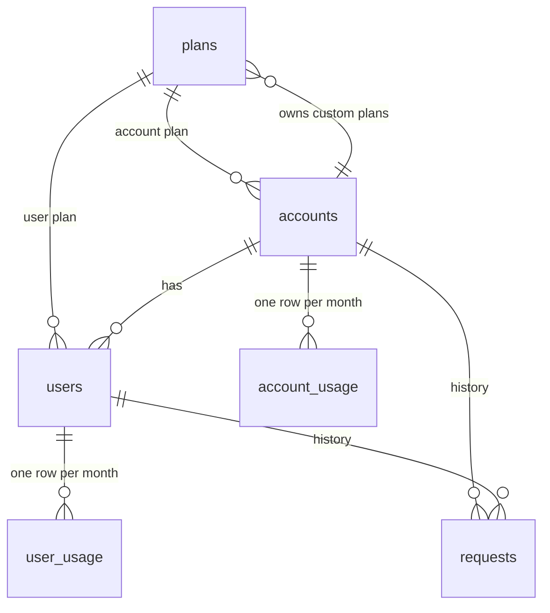
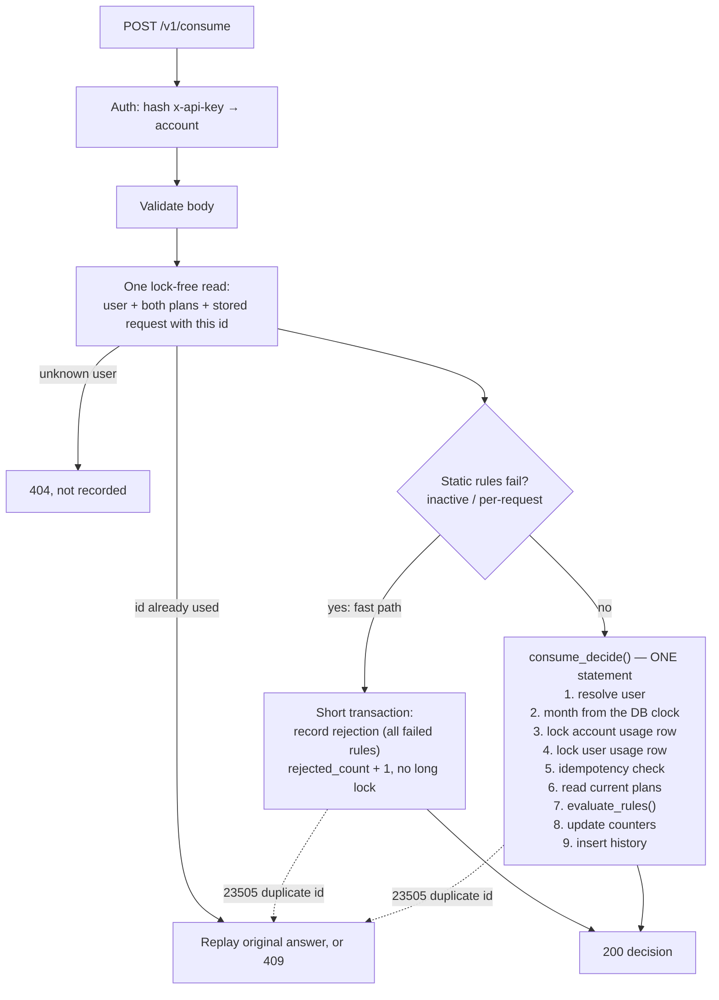

# Usage Metering Service

A small service that lets companies meter and limit how their users consume units (documents, API
calls, credits…). Every company and every user has a monthly quota and a per-request limit.

- **Exact under concurrency:** totals never drift, even with hundreds of parallel requests on one company.
- **Safe retries:** sending the same request twice never counts twice.
- **Every decision is recorded:** accepted and rejected requests are kept in a history with the limits used.

Stack: TypeScript (strict), Node.js 24, Fastify, Zod, Drizzle ORM, PostgreSQL 16, Vitest +
Testcontainers, k6, Next.js (example client), Docker Compose.

---

## Quick start

```bash
docker compose up --build
```

No `.env` is needed: Compose has development defaults. To change them, `cp .env.example .env` and edit.

| What | URL |
|---|---|
| API | http://localhost:50000 (`GET /health`) |
| API docs (Swagger) | http://localhost:50000/docs |
| Example client | http://localhost:60000 |

The dev admin key is `dev-only-admin-key-change-me-0000000000`. **Change it (and the Postgres password)
outside local development.**

> Already ran an older version? Predefined plans now have fixed ids. If the service refuses to start with
> "Predefined plans … have unexpected ids", recreate the database once: `docker compose down -v`.

Local development (Node version is in `.nvmrc`):

```bash
nvm use                 # Node 24
npm ci --prefix service && npm ci --prefix client
npm run test            # type checks (service incl. tests, client), then service and client tests; needs Docker
npm run typecheck       # type checks only (Vitest does not type-check)
npm run loadtest        # k6 scenarios against the running stack (see Load results)
```

There is **no CI** (the CI step was skipped on purpose): run `npm run test` before every commit.

---

## The API by example

All endpoints are under `/v1` and speak JSON. A company calls the service from its own backend with its
API key in `x-api-key`; only company creation uses the admin key. Full reference: [`docs/API.md`](docs/API.md)
and Swagger at `/docs`.

**1. Create a company** (admin). Predefined plans have fixed ids, so no lookup is needed:

```bash
curl -s -X POST localhost:50000/v1/accounts \
  -H 'x-admin-key: dev-only-admin-key-change-me-0000000000' -H 'content-type: application/json' \
  -d '{"name":"Acme Docs","planId":"00000000-0000-4000-8000-000000000001"}'
```
```json
{ "accountId": "…", "name": "Acme Docs", "apiKey": "mk_…", "plan": { "name": "Starter", "monthlyLimit": 10000, "perRequestLimit": 100, "...": "…" }, "createdAt": "…" }
```
The `apiKey` is shown **only here**. Keep it: `export KEY=mk_…`

**2. Register a user** on the predefined Basic plan (1,000/month, 20 per request):

```bash
curl -s -X POST localhost:50000/v1/users -H "x-api-key: $KEY" -H 'content-type: application/json' \
  -d '{"userId":"ali-123","planId":"00000000-0000-4000-8000-000000000003"}'
```

**3. Consume.** 10 units are accepted; 25 units break the user's per-request limit:

```bash
curl -s -X POST localhost:50000/v1/consume -H "x-api-key: $KEY" -H 'content-type: application/json' \
  -d '{"requestId":"doc-7781","userId":"ali-123","units":10}'
```
```json
{ "requestId": "doc-7781", "accepted": true, "units": 10, "failedRules": [], "month": "2026-10",
  "account": { "used": 10, "remaining": 9990, "monthlyLimit": 10000, "perRequestLimit": 100 },
  "user": { "userId": "ali-123", "used": 10, "remaining": 990, "monthlyLimit": 1000, "perRequestLimit": 20 },
  "replayed": false, "decidedAt": "…" }
```
```bash
curl -s -X POST localhost:50000/v1/consume -H "x-api-key: $KEY" -H 'content-type: application/json' \
  -d '{"requestId":"doc-7782","userId":"ali-123","units":25}'
```
```json
{ "requestId": "doc-7782", "accepted": false, "units": 25,
  "failedRules": [ { "scope": "user", "rule": "per_request_limit", "limit": 20, "requested": 25 } ],
  "account": { "used": 10, "...": "…" }, "user": { "used": 10, "...": "…" }, "replayed": false, "...": "…" }
```
Rejections are answered with **200** and `accepted: false`: nothing is consumed, but the decision is recorded.

**4. Retry safely.** Sending `doc-7781` again returns the original answer with `"replayed": true` and
counts nothing. The same `requestId` with different data returns `409 REQUEST_ID_CONFLICT`.

**5. Read usage and history:**

```bash
curl -s localhost:50000/v1/account -H "x-api-key: $KEY"                  # company, plan, usage (?month=YYYY-MM)
curl -s localhost:50000/v1/users/ali-123 -H "x-api-key: $KEY"            # user, plan, usage
curl -s "localhost:50000/v1/requests?userId=ali-123&limit=20" -H "x-api-key: $KEY"   # newest first, cursor paging
```

**Errors** always have the same shape (no stack traces):

```json
{ "error": { "code": "USER_NOT_FOUND", "message": "User 'nobody' not found in this account", "details": { "userId": "nobody" } } }
```

Other endpoints: custom plans (`GET/POST /v1/plans`, `GET/PATCH /v1/plans/:planId`), users
(`GET /v1/users` with cursor, `PATCH /v1/users/:userId`), `PATCH /v1/account` (switch plan),
`GET /v1/requests/:requestId`.

---

## Model



| Table | Purpose |
|---|---|
| `plans` | Limits live only here. Predefined plans (`account_id` NULL) or a company's custom plans. Type `account` or `user`, never changes. |
| `accounts` | The company: name, SHA-256 of its API key, its account plan, active flag. |
| `users` | The company's users: its own `userId` (unique per company), a user plan, active flag. |
| `account_usage` / `user_usage` | Fast monthly counters: `used`, accepted/rejected counts, the limit at last update. Hot rows: `fillfactor = 80`. |
| `requests` | Full history of every decision: failed rules, limits snapshot, remaining and used totals. `UNIQUE (account_id, request_id)` makes retries safe. |

Predefined plans (read-only, fixed ids):

| Plan | Type | Monthly | Per request | `planId` |
|---|---|---:|---:|---|
| Starter | account | 10,000 | 100 | `00000000-0000-4000-8000-000000000001` |
| Pro | account | 100,000 | 1,000 | `00000000-0000-4000-8000-000000000002` |
| Basic | user | 1,000 | 20 | `00000000-0000-4000-8000-000000000003` |
| Premium | user | 10,000 | 200 | `00000000-0000-4000-8000-000000000004` |

The exact design is [`docs/schema.sql`](docs/schema.sql); a test proves the migrations produce exactly it.

---

## Keys and auth

- **API key:** `mk_` + 32 random bytes (base64url). Shown once at creation; only its **SHA-256** is stored
  (a fast hash is safe for 256-bit random keys; bcrypt would add ~100 ms per request). Never logged.
- **Admin key** (`ADMIN_KEY`, ≥ 32 chars): only for `POST /v1/accounts`. Compared in constant time.
- The company (`accountId`) comes **only** from the API key, never from the request. Every query is scoped
  by it: another company's users, plans or requests always answer **404**.
- Auth runs before validation: a missing or wrong key is **401** even if the body is invalid.
  An inactive company gets **403 `ACCOUNT_INACTIVE`**.

## Rules

Every consume checks all rules and reports **every** failure, always in this order:

| # | Scope | Rule | Fails when |
|---|---|---|---|
| 1 | user | `inactive` | the user is deactivated |
| 2 | user | `per_request_limit` | `units > user plan per-request limit` |
| 3 | account | `per_request_limit` | `units > account plan per-request limit` |
| 4 | user | `monthly_limit` | `user used + units > user plan monthly limit` |
| 5 | account | `monthly_limit` | `account used + units > account plan monthly limit` |
| 6 | user | `rate_limit` | the user plan has `rateLimitPerMinute` and it is already used up this minute |
| 7 | account | `rate_limit` | the account plan has `rateLimitPerMinute` and it is already used up this minute |

The rate limit is optional (plans default to `null`): it counts only **accepted** requests in a fixed UTC
minute, so up to 2×N can pass across a minute boundary. Exactly at the limit is accepted. `remaining = max(0, limit − used)`, never negative. Months are UTC and
decided by the **database clock**, never the app server. Units and limits are integers only.

## Plan changes

- Changes apply to the **next** request after they commit (plans are read after the usage locks).
- Switching a company or user to another plan **keeps usage**: no fresh allowance mid-month.
- Lowering a limit below current usage gives `remaining: 0`, and further requests are rejected.
- History keeps the limits that were used at decision time (`limits_snapshot`).
- Custom plans can be edited and (de)activated; predefined plans are read-only (**403**). A plan that is still
  assigned can't be deactivated (**409 `PLAN_IN_USE`**): assignment holds the plan row `FOR SHARE`,
  deactivation takes it `FOR UPDATE`, so the two can never interleave.

## Retries

- Same `requestId` + same `userId` and `units` → `200` with the **original** answer and `"replayed": true`.
- Same `requestId` + different data → `409 REQUEST_ID_CONFLICT`.
- Request ids are unique **per company**; two companies can use the same id.
- A retry is answered from one lock-free read. If two identical requests race, the unique key decides the
  winner and the loser is answered as a replay (a safety net that makes double counting impossible).

---

## Design



- **Exact totals with row locks:** all consumes of one company serialize on its monthly usage row. Lock
  order is always account usage row → user usage row → requests unique key (the history insert comes
  last on both the fast and the locked path), so deadlocks can't happen. Totals are never computed by
  summing history on the hot path.
- **Consume v2:** the locked part runs as one PL/pgSQL function (`consume_decide()`), so the decision is a
  single round trip. Its rules (`evaluate_rules()`) are the SQL twin of
  [`service/src/domain/rules.ts`](service/src/domain/rules.ts); a parity test (2,000+ cases) keeps them identical.
- **Bad requests don't block good ones:** requests that fail a usage-independent rule never take the long lock.
- **One data store:** PostgreSQL only (no Redis, no queues). Migrations run on start under an advisory lock;
  predefined plans are seeded idempotently.
- **Layers:** `routes.ts` (HTTP + Zod) → `service.ts` (logic) → `repo.ts` (SQL, parameterized only).
  Errors use one `AppError` with codes from `docs/API.md`; logs are pino JSON with a `requestId` on every line.

```
service/src/   app.ts server.ts config.ts errors.ts
               auth/  db/  domain/rules.ts  lib/  modules/{accounts,plans,users,consume,history}
client/        Next.js example app (App Router, Server Actions, CSS Modules)
loadtest/      k6 scenarios, totals check, RESULTS.md
docs/          specs, decisions, and a log of every build step (docs/steps/)
```

The full algorithm, with reasons for each step, is in [`docs/CONSUME.md`](docs/CONSUME.md).

## The example client

`http://localhost:60000` plays the company's own app ([`docs/DEMO.md`](docs/DEMO.md)): process documents
for Ali and Sara, watch company and user usage bars, switch plans, edit the shared "Demo Team" limits, see
the last 10 decisions, and reset. On first load it creates the demo company through the public API. The API
key stays on the Next.js server; the browser never sees it.

---

## Assumptions

From [`docs/DECISIONS.md`](docs/DECISIONS.md) and decisions made while building:

- Months are calendar months in **UTC**, decided by the database clock. History keeps old limits.
- Only integers: units ≥ 1 (≤ 2,147,483,647 per request), limits ≥ 1 (no "unlimited", no 0 limits; to block
  a user, deactivate them).
- A plan is required when creating a company or user (no hidden defaults). Companies get account-type plans,
  users get user-type plans (`400 PLAN_TYPE_MISMATCH` otherwise).
- Custom plan names are unique per company and can't reuse a predefined plan's name.
- No hard deletes anywhere: users and custom plans are deactivated instead.
- Users never call the service; the company's backend does. `userId` / `requestId` are kept exactly as sent
  (1–128 characters, URL-encode them in paths).
- Request bodies are strict: unknown fields are a `400`.
- Lists (users, history) are newest first with an opaque cursor.

## Testing

`npm run test` (Docker required: tests use a real PostgreSQL via Testcontainers, never mocks). It first runs
`npm run typecheck` — `tsc --noEmit` for the service (source and tests) and the client — and stops on any type
error, because Vitest runs TypeScript without checking types.

| Kind | What it proves |
|---|---|
| Unit | Rules (every case in `docs/TESTING.md`), config, keys, months, client helpers |
| Integration | Every endpoint over real HTTP and a real database: auth (401/403), company isolation (404), plans, users, consume (the brief's examples, retries, plan changes, months), history, migrations == `schema.sql`, rules TS == SQL |
| Concurrency | 200 parallel requests on 1,000 units → exactly 100 accepted; 50 identical requests → counted once; bad requests don't slow good ones; lowering a plan under load; totals always exact |

Currently 210 tests (191 service, 8 concurrency, 11 client), all green.

## Load results

k6, 50 virtual users per scenario, 60 s measured, on one 4-vCPU VM running service, Postgres **and** k6
(compare scenarios with each other, not as capacity numbers). Full report: [`loadtest/RESULTS.md`](loadtest/RESULTS.md).

| Scenario | v1 req/s | v2 req/s | v1 p50 → v2 p50 |
|---|---:|---:|---|
| Spread: 100 companies × 10 users | 321 | 694 | 144 → 67 ms |
| Hot: 1 company × 200 users | 133 | 241–287 | 347 → 151–181 ms |
| Retry storm (20% resent) | 391 | 678 | 118 → 69 ms |
| Reads | 1,172 | 1,150 | 38 → 40 ms |

0 errors, and the totals check found **0 mismatches** after every run.

- **Bottleneck found:** the hot company's usage row. ~95% of active Postgres backends were waiting on it,
  because v1 held it across ~9 round trips. Spread load was database-bound by statement count (~12 per consume).
- **What changed:** consume v2 (one statement under the lock) and one merged pre-read: 2 statements per
  accepted consume. Retries are the cheapest path (one read, no lock).

## Tradeoffs and limitations

- **One company is serialized on its row.** That's the price of exact totals. The row is now held ≈ 3.5–4 ms
  per request, mostly the durable commit (`synchronous_commit = on`). Further options, not taken:
  `synchronous_commit = off` (faster, can lose the last few hundred ms of decisions on a crash) or splitting the
  counter into N rows (spreads contention, changes the exact-totals design).
- **Rules exist twice** (TypeScript for the fast path, SQL for the locked path), guarded by the parity test.
- **History grows forever.** Future: monthly partitioning.
- **Single database** = single point of failure.
- **Client API types** are hand-written from `docs/API.md` and can drift (no shared package, by choice).
- **Demo client:** keeps the demo API key in server memory (a restart creates a new demo company) and holds
  the admin key server-side to create it.
- **No CI**: run the tests locally before committing.
- Load numbers come from one shared machine.

## Project docs

| Document | Content |
|---|---|
| [`docs/API.md`](docs/API.md) | Exact endpoints, fields, status and error codes |
| [`docs/CONSUME.md`](docs/CONSUME.md) | The consume algorithm, step by step, and why |
| [`docs/DECISIONS.md`](docs/DECISIONS.md) | Every product and tech decision |
| [`docs/schema.sql`](docs/schema.sql) | The exact database design |
| [`docs/TESTING.md`](docs/TESTING.md) | What must be tested |
| [`docs/DEMO.md`](docs/DEMO.md) | The example client and its story |
| [`loadtest/RESULTS.md`](loadtest/RESULTS.md) | Load test numbers, bottleneck, before/after |
